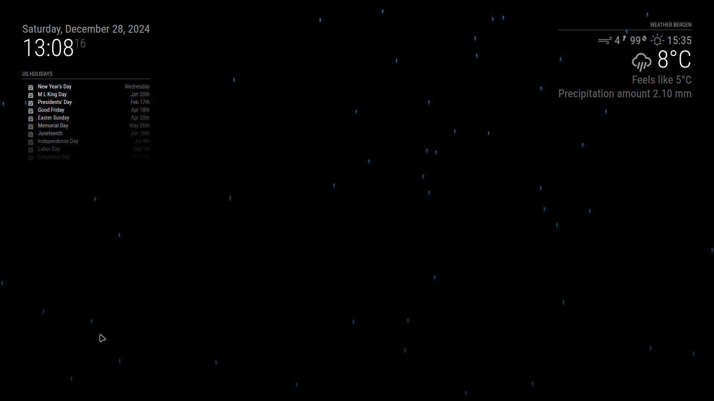
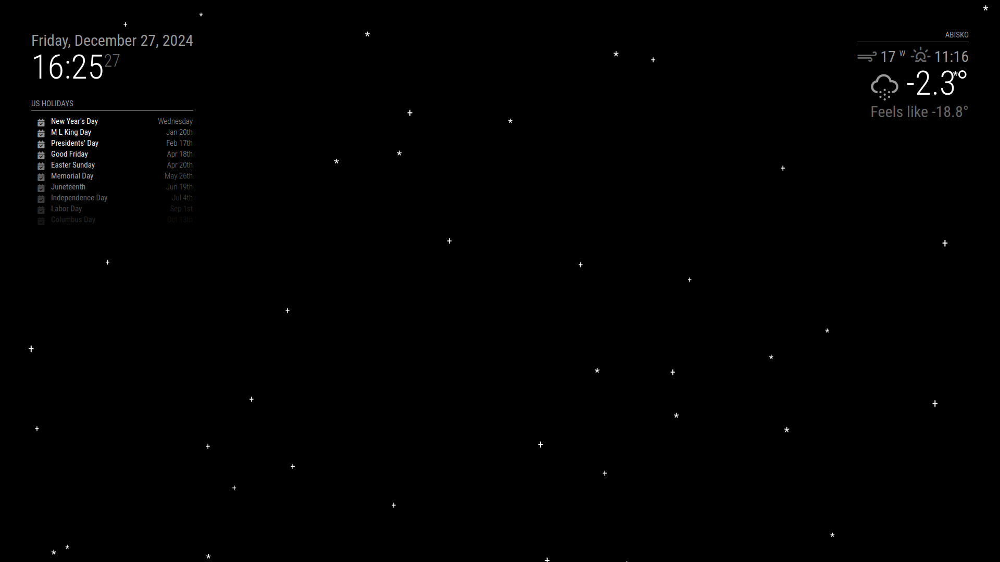
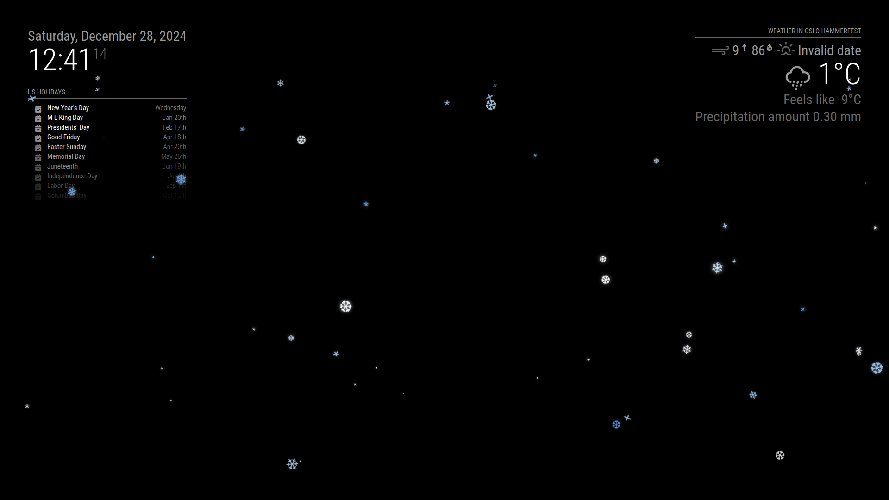

# MMM-WeatherEffects

<div align="center">

[](https://opensource.org/licenses/MIT)
[](https://github.com/cgillinger/MMM-WeatherEffects)
[](https://magicmirror.builders)
[](https://github.com/cgillinger/MMM-WeatherEffects)
[](https://github.com/cgillinger/MMM-WeatherEffects/issues)
[](https://github.com/cgillinger/MMM-WeatherEffects/pulls)

**A MagicMirror² module that adds immersive, dynamic weather effects — rain and snow — based on real-time weather conditions.**

_Automatically detects your current weather and renders stunning fullscreen animations on your Magic Mirror display._

[Quick Start](#quick-start) · [Configuration](#configuration-options) · [Screenshots](#visual-examples) · [Troubleshooting](#troubleshooting) · [Contributing](#contributing)

</div>

---

> This is a personal hobby project I build for my own use and publish in case it's useful to someone else. I work on it in my spare time, so issues and PRs are welcome but replies may be slow. Use at your own risk.

---

## Features

- **Automatic weather detection** — triggers effects based on live weather notifications
- **Dynamic rain effects** — configurable droplet count, speed, and wind direction
- **Beautiful snow effects** — supports both lightweight ASCII and rich Unicode snowflakes (❄)
- **Smooth transitions** — animated fade between weather states
- **Performance-optimized** — tunable for Raspberry Pi and high-powered displays alike
- **Flexible configuration** — fine-grained control over every visual parameter
- **Custom keyword support** — adapt to any weather provider's terminology

---

## Visual Examples

The module renders fullscreen weather overlays with configurable styles and intensities:

### Rain Effect

*Rain with configurable droplet count, speed, and wind direction*

### Snow Effect — Light Mode

*ASCII characters (`*`, `+`) — recommended for Raspberry Pi and low-power devices*

### Snow Effect — Rich Mode

*Unicode snowflakes (❄) — visually stunning on powerful displays*

---

## Quick Start

Add the following to your `config/config.js` to get started immediately:

```javascript
{
    module: "MMM-WeatherEffects",
    position: "fullscreen_above"  // Recommended — effects render as a fullscreen overlay regardless
}
```

That's all! The module works out of the box with sensible defaults. See [Configuration Options](#configuration-options) for full customization.

---

## Installation

### Step 1: Clone the Repository

```bash
cd ~/MagicMirror/modules
git clone https://github.com/cgillinger/MMM-WeatherEffects.git
```

### Step 2: Add to Your Config

Add a full configuration block to `config/config.js`:

```javascript
{
    module: "MMM-WeatherEffects",
    position: "fullscreen_above",
    config: {
        enabled: true,
        rainConfig: {
            dropletCount: 50,
            dropletSpeed: 2.0,
            windDirection: "none"  // "none" | "left-to-right" | "right-to-left"
        },
        snowConfig: {
            flakeCount: 25,
            characters: ['*', '+'],
            sparkleEnabled: false,
            minSize: 0.8,
            maxSize: 1.5,
            speed: 1.0
        }
    }
}
```

---

## Configuration Options

### General Settings

| Option | Description | Default | Options |
|--------|-------------|---------|---------|
| `enabled` | Master on/off switch | `true` | `true` / `false` |
| `transitionDuration` | Transition time (ms) | `1000` | Any integer |

> **Note:** `rainConfig` and `snowConfig` can be partial — any option you leave out keeps its default value.

### Rain Settings (`rainConfig`)

| Option | Description | Default | Range |
|--------|-------------|---------|-------|
| `dropletCount` | Number of raindrops | `50` | 1–200 |
| `dropletSpeed` | Falling speed multiplier | `2.0` | 0.1–5.0 |
| `windDirection` | Rain angle / wind effect | `"none"` | `"none"` `"left-to-right"` `"right-to-left"` |

### Snow Settings (`snowConfig`)

| Option | Description | Default | Range / Notes |
|--------|-------------|---------|---------------|
| `flakeCount` | Number of snowflakes | `25` | 1–100 |
| `characters` | Snowflake characters | `['*', '+']` | Any character array |
| `sparkleEnabled` | Glow/sparkle effect | `false` | `true` / `false` |
| `minSize` | Minimum flake size (em) | `0.8` | Floating point |
| `maxSize` | Maximum flake size (em) | `1.5` | Floating point |
| `speed` | Falling speed multiplier | `1.0` | 0.1–5.0 |

---

## Performance Recommendations

### Raspberry Pi and Low-Power Devices

Reduce particle counts and disable visual enhancements:

```javascript
config: {
    rainConfig: {
        dropletCount: 30
    },
    snowConfig: {
        flakeCount: 15,
        sparkleEnabled: false,
        maxSize: 1.2
    }
}
```

### Powerful Displays (Desktop / High-End SBC)

Enable rich snowflakes and sparkle for maximum visual impact:

```javascript
config: {
    rainConfig: {
        dropletCount: 100
    },
    snowConfig: {
        flakeCount: 50,
        characters: ['❄', '❆', '*'],
        sparkleEnabled: true,
        maxSize: 2.0
    }
}
```

---

## CSS Customization

Override default styles by creating a `custom.css` file in your MagicMirror `css/` directory.

### Rain Appearance

```css
.rain-particle {
    width: 4px;
    height: 16px;
    opacity: 0.8;
    background: linear-gradient(to bottom, #00aaff, transparent);
}
```

### Snow Appearance

```css
/* Base snowflake style */
.snow-particle {
    color: white;
    opacity: 0.8;
}

/* Color variants */
.snow-particle.blue-light  { color: #BDE3FF !important; }
.snow-particle.blue-medium { color: #99CCFF !important; }
.snow-particle.blue-dark   { color: #66A3FF !important; }
.snow-particle.crystal     { color: #F0F8FF !important; }

/* Sparkle glow */
.snow-particle.sparkle {
    text-shadow: 0 0 8px rgba(255,255,255,0.8);
}
```

### Animation Speed

```css
/* Slow down rain (higher = slower) */
.rain-particle  { animation-duration: 2s !important; }

/* Slow down snow */
.snow-particle  { animation-duration: 5s !important; }
```

> **Tip:** Start with small adjustments and test each change before applying more.

---

## Customizing Weather Detection

The file `weather-keywords.json` maps weather condition strings to effects. Edit this to match your weather provider's terminology:

```json
{
    "effects": {
        "rain": ["rain", "showers", "drizzle", "precipitation"],
        "snow": ["snow", "sleet", "blizzard", "flurries"]
    }
}
```

Changes are picked up automatically — no restart needed.

If keywords of both effects match, the longest matching keyword wins, so `snow_showers` shows snow and not rain. If both are equally long, snow wins.

The module reacts to these notifications:

- `CURRENTWEATHER_TYPE` from the default weather module
- `OPENWEATHER_FORECAST_WEATHER_UPDATE` from [MMM-OpenWeatherForecast](https://github.com/jclarke0000/MMM-OpenWeatherForecast) and similar modules. The English condition (`main`) and the localized description are both checked, so localized keywords work as well.

---

## Testing

Run `node --test` in the module directory.

---

## Troubleshooting

### No effects are showing
- Verify your weather module is correctly configured and running
- Open the browser console and check for incoming weather notifications
- Explicitly set `enabled: true` in your config
- Confirm that `weather-keywords.json` includes your provider's condition strings

### Poor performance / lag
- Lower `dropletCount` and `flakeCount`
- Disable `sparkleEnabled`
- Switch to ASCII characters instead of Unicode snowflakes
- Reduce `maxSize` values

### Weather conditions not triggering effects
- Check the browser console for notification payloads from your weather module
- Verify the condition text matches entries in `weather-keywords.json`
- Add any missing terms to the keywords file

---

## Compatibility

| Component | Requirement |
|-----------|-------------|
| MagicMirror² | `>= 2.20.0` |
| Weather Module | Any module that emits weather type notifications |
| Browser | All modern browsers (Chrome, Firefox, Safari, Edge) |
| Hardware | Raspberry Pi, desktop, or any device running MagicMirror² |

---

## Changelog

### v1.1.0 (2026-07-12)

Bug-fix release — no configuration changes needed on your side.

- **Custom weather keywords now actually work.** Two bugs prevented `weather-keywords.json` from ever being read: the helper file was named `node-helper.js` (MagicMirror² only loads `node_helper.js`), and it then looked for the file under the wrong name. Your customizations were silently ignored and a shorter built-in list was used instead. Both are fixed, and edits to the file are picked up without restarting the mirror.
- **Effects no longer get stuck on screen.** When the weather changed rain → snow → rain, the previous effect was never cleaned up, leaving snow and rain running at the same time until reboot.
- **Fixed a crash with partial configuration.** Setting e.g. only `snowConfig: { flakeCount: 15 }` crashed the snow effect. Any option you leave out now falls back to its default.
- **Rain and snow now fall all the way to the bottom of the screen.** Particles used to vanish up to 200 px above the bottom edge.
- **Fixed duplicated keyword loading** after browser reloads (each reload leaked a file watcher).
- **Removed** the unused `intensity` option (it was documented but never implemented — leaving it in your config is harmless) and the broken `MMM-WeatherEffects_Alternate.js` file, which contained an old copy of this README rather than runnable code.

### v1.0.1 (2026-01-11)

- Fixed: portrait mode coverage — particles distributed across full screen height
- Added: random vertical start positions and staggered animation delays

### v1.0.0 (2024-12-28)

- Initial release: rain effects with wind direction, multi-color snow, smooth transitions, weather condition detection

---

## Contributing

Contributions, bug reports, and feature requests are welcome!

- Open an issue: [GitHub Issues](https://github.com/cgillinger/MMM-WeatherEffects/issues)
- Submit a pull request: [GitHub PRs](https://github.com/cgillinger/MMM-WeatherEffects/pulls)

---

## Credits

- Created by **Christian Gillinger**
- Built on [MagicMirror²](https://magicmirror.builders) by Michael Teeuw

---

## License

Distributed under the **MIT License**. See [LICENSE](LICENSE) for full details.
